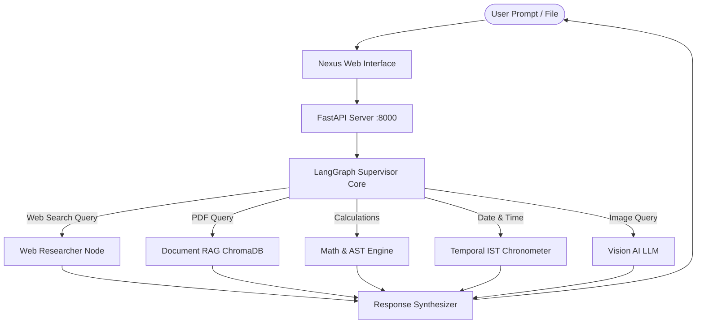

# Nexus Agentic AI — Autonomous Multi-Agent Workspace

An enterprise-grade autonomous multi-agent intelligence workspace built with **LangGraph**, **FastAPI**, **Ollama (`llama3.2`)**, **ChromaDB**, and **React (Vite)**.


---

## 🌟 Key Features

- **🧠 LangGraph Multi-Agent Supervisor Network**: Autonomous supervisor routing to specialized worker agents.
- **🌐 Live Web Researcher**: Real-time web scraping and fact extraction via DuckDuckGo search.
- **📄 Document Intelligence (RAG)**: PDF ingestion with recursive character splitting, HuggingFace embeddings (`all-MiniLM-L6-v2`), and ChromaDB similarity search.
- **🧮 Math & Symbolic Logic Engine**: Safe AST-based deterministic mathematical evaluator.
- **👁️ Computer Vision Perceiver**: Multi-modal vision analysis for uploaded images, charts, and diagrams (`llama3.2-vision`).
- **⏱️ Temporal IST Sync**: Real-time verified Indian Standard Time chronometry.
- **🔊 Voice Synthesis (TTS)**: In-browser text-to-speech to read responses aloud.
- **✨ Modern Light Theme**: Clean, ceramic off-white aesthetic with custom accent switchers (Indigo, Cyan, Emerald, Amber, Purple).
- **📥 Session Export**: One-click conversation export to Markdown (`.md`).
- **⚡ Code Artifacts Studio**: Syntax-highlighted code blocks with 1-click copy and file download.

---

## 🏗️ Architecture



---

## 🚀 Quick Start

### 1. Prerequisites
- **Python 3.10+**
- **Node.js 18+**
- **Ollama** running locally with `llama3.2`:
  ```bash
  ollama run llama3.2
  ```

### 2. Backend Setup
```bash
cd backend
python -m venv venv
.\venv\Scripts\activate   # Windows
# source venv/bin/activate # Linux / macOS

pip install -r requirements.txt
uvicorn main:app --host 127.0.0.1 --port 8000 --reload
```

### 3. Frontend Setup
```bash
cd frontend
npm install
npm run dev
```

Open [http://127.0.0.1:5173/](http://127.0.0.1:5173/) in your browser.

---

## 📄 License
MIT License. Created by [Kasthuri-07](https://github.com/Kasthuri-07).
